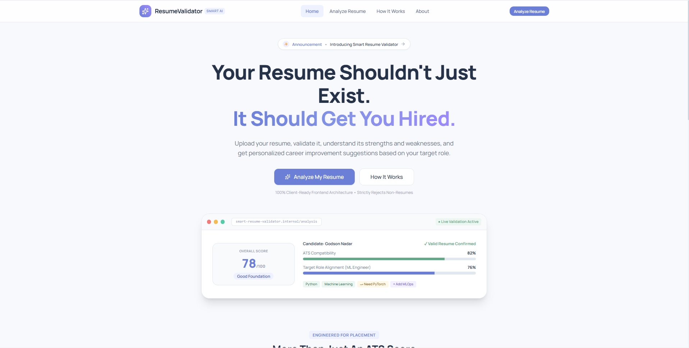
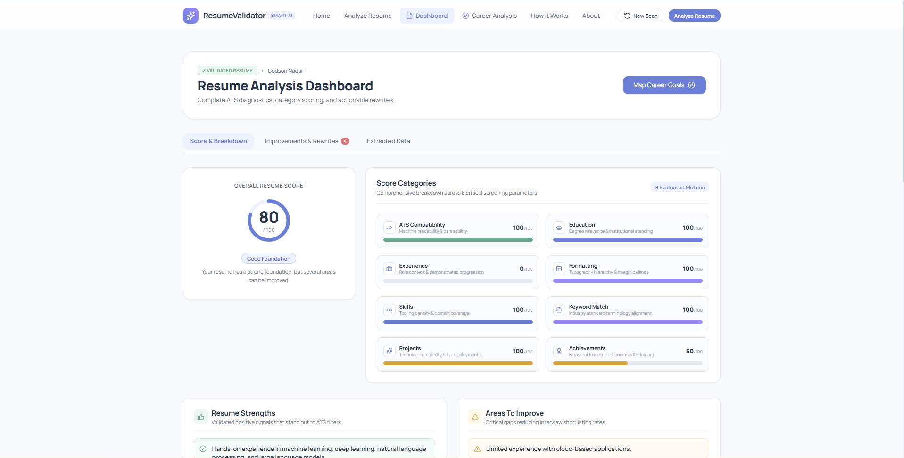
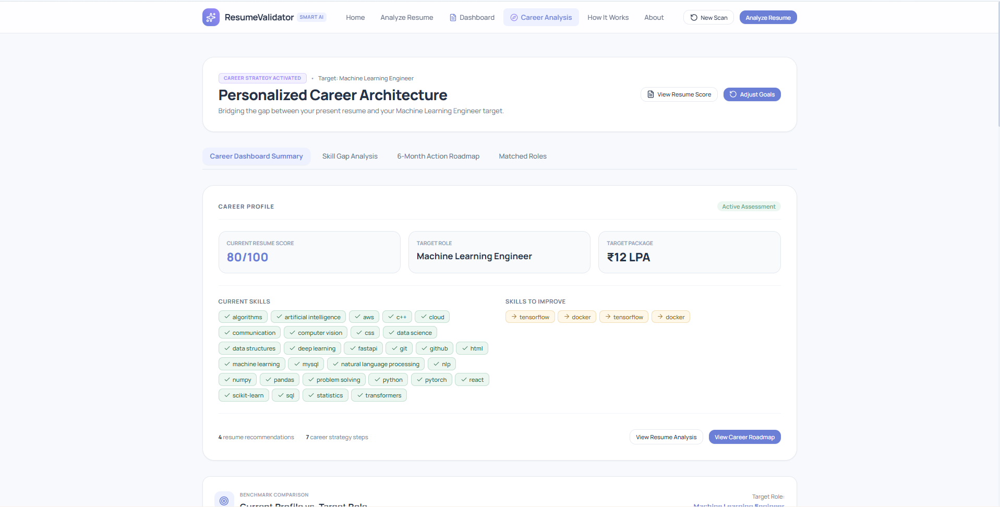
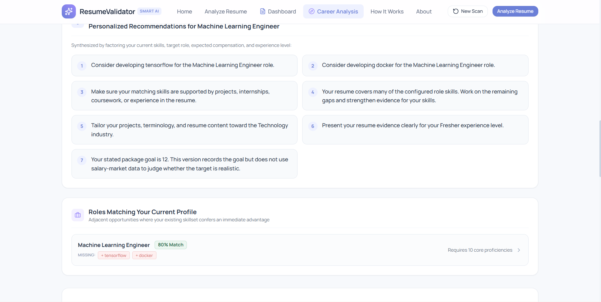
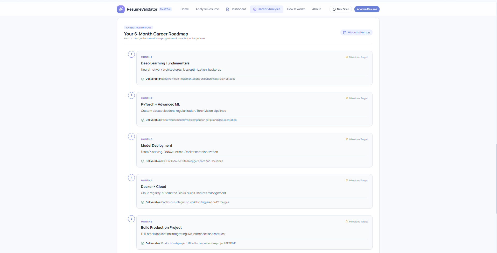

# 📄 Smart Resume Validator

### An NLP-Powered Resume Analysis and Career Growth Platform

**Smart Resume Validator** is a Natural Language Processing (NLP) mini-project that analyzes resumes, validates uploaded documents, evaluates resume quality, and generates personalized career improvement recommendations based on a user's target role and career goals.

The system combines resume parsing, rule-based scoring, AI-assisted analysis, skill-gap identification, job-description matching, and career roadmap generation to help users understand their current profile and identify areas for improvement.

## 🖥️ Project Preview

### 🏠 Home Page



*The landing page introduces the platform and guides users toward resume analysis.*

### 📊 Resume Analysis Dashboard



*Displays the resume score, category-wise evaluation, strengths, weaknesses, and improvement suggestions.*

### 🎯 Personalized Career Dashboard



*Summarizes the user's resume score, target role, existing skills, and career strategy.*

### 💡 Career Recommendations and Role Matching



*Presents personalized improvement recommendations and related role matches based on the user's profile.*

### 🗺️ Six-Month Career Roadmap



*Organizes suggested learning and development activities into a milestone-driven roadmap.*

## 🎯 Project Objectives

- Validate whether an uploaded document appears to be a genuine resume before scoring it.
- Extract relevant information such as contact details, education, skills, projects, and experience.
- Evaluate resume quality using multiple scoring categories.
- Identify strengths, weaknesses, and areas requiring improvement.
- Analyze the gap between existing skills and a target career role.
- Match resume content against a supplied job description.
- Generate personalized career recommendations and a structured action plan.
- Demonstrate how NLP and AI-assisted analysis can support resume improvement.

## ✨ Key Features

### 1. Resume Validation
Checks whether the uploaded document contains sufficient resume-related information. Documents that fail validation are rejected before resume scoring.

### 2. Resume Scoring
Evaluates resume quality across categories such as ATS compatibility, contact information, education, skills, experience, projects, achievements, and formatting.

### 3. Resume Information Extraction
Extracts relevant information from supported documents, including skills, education, projects, contact details, and other resume sections.

### 4. Resume Intelligence
Examines resume structure, skill categories, professional evidence, achievements, measurable outcomes, and possible improvement areas.

### 5. Personalized Improvement Suggestions
Provides actionable suggestions to strengthen resume content, improve descriptions, and present skills and achievements more effectively.

### 6. Career Goal Analysis
Uses the user's target role, industry, experience level, and stated package goal to organize career-related recommendations.

### 7. Skill Gap Analysis
Compares skills identified in the resume with the requirements associated with the target role or supplied job description.

### 8. Job Description Matching
Analyzes overlap between resume skills and job-description requirements, highlighting matching skills, missing requirements, and possible resume-tailoring improvements.

### 9. Career Recommendations
Suggests learning priorities, related roles, project ideas, and profile improvements based on the available resume and career information.

### 10. Career Roadmap
Presents suggested milestones in a structured roadmap to help users plan their learning and professional development.

## ⚙️ System Workflow

The application follows this general pipeline:

1. **Upload Resume:** The user uploads a supported resume document.
2. **Document Processing:** The backend extracts readable text from the document.
3. **Resume Validation:** The system checks whether the document appears to be a resume.
4. **Information Extraction:** Relevant resume information is identified.
5. **Resume Evaluation:** The system calculates a score and evaluates different resume categories.
6. **Improvement Analysis:** Strengths, weaknesses, and suggestions are generated.
7. **Career Goal Submission:** The user provides a target role and other career preferences.
8. **Skill Gap Analysis:** Existing skills are compared with target-role or job-description requirements.
9. **Career Recommendations:** The system generates relevant recommendations and related-role suggestions.
10. **Action Roadmap:** The results are presented through the frontend dashboard.

## 🧠 Technologies Used

### Frontend
- **React.js** — Component-based user interface
- **JavaScript** — Frontend logic and API integration
- **CSS** — Styling and responsive layouts
- **Vite** — Frontend development server and build tooling

### Backend
- **Python** — Core application logic
- **FastAPI** — REST API development
- **Uvicorn** — ASGI server
- **Pydantic** — Request validation and data models

### NLP and AI
- **Qwen2-VL-2B-Instruct** — Local AI model used for AI-assisted resume analysis
- **PyTorch** — Model inference
- **Transformers** — Model loading and inference utilities
- **Regular Expressions** — Pattern-based information extraction and validation
- **Rule-Based NLP Processing** — Resume scoring, skill identification, and requirement matching

### Document Processing and Storage
- **PyMuPDF** — PDF text extraction
- **python-docx** — DOCX document processing
- **SQLite** — Local database persistence

### Development Tools
- **Visual Studio Code**
- **Git**
- **GitHub**
- **Swagger UI** — API testing and documentation

## 🏗️ System Architecture

The application follows a frontend-backend architecture.

```text
                 USER
                  |
                  v
          REACT FRONTEND
                  |
             REST API
                  |
                  v
           FASTAPI BACKEND
                  |
       +----------+-----------+
       |          |           |
       v          v           v
  Document     Resume       Database
  Processing   Analysis     (SQLite)
       |          |
       +-----+----+
             |
             v
       Career Analysis
             |
             v
   Skill Gap and Recommendations
             |
             v
       JSON API Response
             |
             v
       React Dashboard
```

## 📁 Project Structure

```text
smart-resume-validator/
│
├── backend/
│   ├── app/
│   │   ├── api/
│   │   ├── core/
│   │   ├── db/
│   │   ├── models/
│   │   ├── services/
│   │   └── main.py
│   │
│   ├── experiments/
│   └── requirements.txt
│
├── frontend/
│   ├── public/
│   ├── src/
│   │   ├── career/
│   │   ├── components/
│   │   ├── context/
│   │   ├── hooks/
│   │   ├── pages/
│   │   ├── resume/
│   │   ├── services/
│   │   └── utils/
│   ├── package.json
│   └── vite.config.ts
│
├── screenshots/
│   ├── home.png
│   ├── resume-dashboard.png
│   ├── career-dashboard.png
│   ├── career-recommendations.png
│   └── career-roadmap.png
│
├── .gitignore
├── package-lock.json
└── README.md
```

## 🚀 Getting Started

### Prerequisites

Install the following tools:

- Python 3.12
- Node.js and npm
- Git
- Visual Studio Code

The local AI model may require additional disk space and memory. GPU acceleration is optional for environments supported by the installed PyTorch configuration.

### 1. Clone the repository

```bash
git clone https://github.com/Godson-1307/smart-resume-validator.git
cd smart-resume-validator
```

### 2. Set up the Python environment

From the project root, create a virtual environment:

**Windows PowerShell**

```powershell
python -m venv nlp
.\nlp\Scripts\Activate.ps1
```

If PowerShell blocks script activation, consult the Python virtual-environment documentation or activate the environment using the method configured on your machine.

### 3. Install backend dependencies

```powershell
cd backend
python -m pip install -r requirements.txt
```

### 4. Start the backend

Run this command from the `backend` directory:

```powershell
python -m uvicorn app.main:app --reload
```

The backend should be available at:

- API: http://127.0.0.1:8000
- Interactive API documentation: http://127.0.0.1:8000/docs
- Health check: http://127.0.0.1:8000/health

### 5. Start the frontend

Open a second terminal in the project root and run:

```powershell
cd frontend
npm install
npm run dev
```

Open the local URL displayed by Vite, usually:

http://localhost:5173

Keep both servers running while testing the local application.

### 6. Configure environment variables

Configure any required environment variables according to the project's configuration.

For local AI analysis, use the model and dependencies configured in the backend. A cloud deployment may require a different AI configuration because the local Qwen model can be too resource-intensive for small hosting instances.

**Security note:** Do not commit `.env` files, API keys, private credentials, uploaded resumes, or personal resume data to GitHub.

## 🔌 Main API Endpoints

The backend provides endpoints for the main application workflows.

| Endpoint | Purpose |
|---|---|
| `GET /` | API welcome message |
| `GET /health` | Health check |
| `POST /api/resume/upload` | Upload a resume |
| `GET /api/resume/{resume_id}/validate` | Validate a resume |
| `GET /api/resume/{resume_id}/full-analysis` | Retrieve the full resume analysis |
| `GET /api/resume/{resume_id}/advanced-intelligence` | Retrieve advanced resume intelligence |
| `POST /api/resume/{resume_id}/career-analysis` | Analyze a career goal |
| `POST /api/resume/{resume_id}/career-recommendations` | Generate career recommendations |
| `POST /api/resume/{resume_id}/job-match` | Match a resume against a job description |
| `GET /api/resume/{resume_id}/history` | Retrieve a resume's history |
| `GET /api/resume/history/all` | Retrieve saved resume records |

For request formats, response examples, and interactive testing, start the backend and visit `/docs`.

## 🔍 Project Scope and Limitations

- Resume validation and scoring are based on implemented validation rules and scoring criteria; results are estimates rather than guarantees of recruiter decisions.
- Extraction quality depends on document formatting, text readability, and the quality of the uploaded file.
- Career recommendations depend on the information available in the resume, the target role, and the implemented analysis logic.
- Job-description matching indicates textual and skill overlap; it does not guarantee job eligibility or selection.
- Salary or package goals are recorded as user preferences and should not be interpreted as verified market-salary predictions.
- The locally configured Qwen model requires compatible dependencies and sufficient compute resources.
- Local SQLite data and uploaded files require appropriate persistent storage when moving to a cloud deployment.

## 🔬 Project Significance

Smart Resume Validator explores the practical application of NLP and AI-assisted analysis to resume processing and career planning. Instead of limiting the system to a single resume score, the project connects document validation, resume evaluation, job-specific matching, and career recommendations in one workflow.

The project is an academic prototype intended to demonstrate information extraction, rule-based analysis, model-assisted processing, and API-based application development.

## 🎓 Academic Information

- **Institution:** St. Francis Institute of Technology (SFIT)
- **Department:** Artificial Intelligence and Machine Learning
- **Course:** Natural Language Processing (NLP)
- **Project:** Smart Resume Validator — Career Growth SaaS Platform
- **Guide:** Dr. Vaqar Ansari

## 👥 Team

- **Godson Nadar** — Roll No. 44
- **Jhoshua Coutinho** — Roll No. 43

## 📄 License

No license has currently been specified. Please contact the project contributors before reusing or redistributing the code.
